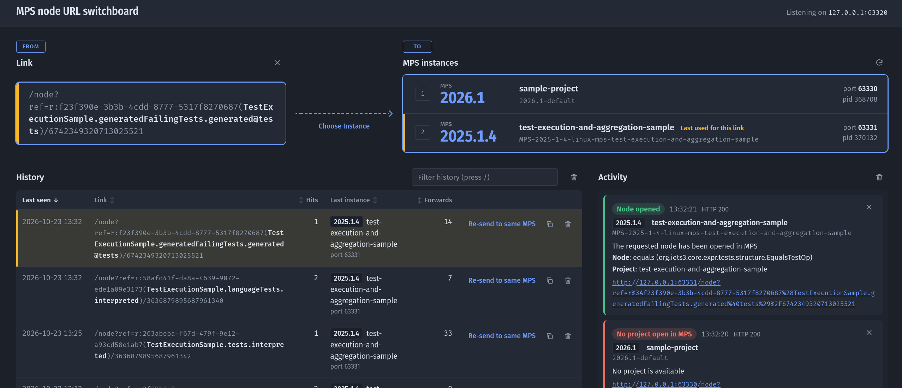

# mps-node-url-switchboard

Owns the default MPS HTTP port (`63320`) so node URLs such as
`http://127.0.0.1:63320/node?ref=...` no longer land in whichever MPS happened to grab the port.
Each request is answered with a page listing the running MPS instances (MPS version, project,
`.mpsconfig` identifier, as written by [mps-zookeeper](https://github.com/nkoester/mps-zookeeper)). Choosing one makes the daemon send the original path+query to that instance;
the page stays open and a side panel shows each forwarded link, the target instance, the HTTP status and
the outcome MPS reports: "Node opened" (with node and concept), "Node not found" (MPS answers 200 either way, so
the reply text is read), "No project open in MPS", or an error. Only an opened node clears the selected link. The history of handled links is shown on the same page.

<table>
  <tr>
    <td width="50%"></td>
    <td width="50%"><video src="https://github.com/user-attachments/assets/05d85517-bf2f-4ae9-a008-696398807579" controls muted width="100%"></video></td>
  </tr>
</table>

- Linux only for now: instance discovery reads `/proc`, window focusing uses sway/wmctrl, autostart is a systemd user unit
- Python 3 stdlib only, single file: `mps_node_url_switchboard.py`
- Listens on `127.0.0.1` only
- MPS instances are discovered on every request (cached 2 s), so instances started later show up automatically
- Handled links are stored in SQLite (`${XDG_STATE_HOME:-~/.local/state}/mps-node-url-switchboard/history.db`) and survive reboots.
  A history from the tool's former name (`mps-port-handler`) is moved there on first start

## Usage

```sh
python3 mps_node_url_switchboard.py                    # serve on 63320
python3 mps_node_url_switchboard.py serve --port 63399 --db /tmp/h.db
python3 mps_node_url_switchboard.py discover           # version, project, .mpsconfig id, port, pid
```

| URL | Purpose |
|---|---|
| `/` | Instances, forward panel and history (no link selected) |
| `/node?...` (any other path) | Same page with this link selected; recorded in the history |
| `POST /__forward` | Daemon sends the link to the chosen instance (or the last used one for "Re-send to same MPS") |
| `POST /__raise` | Focus the window of an instance (used when clicking an instance with no link selected) |
| `/__instances`, `/__history` | HTML fragments; the page refreshes the instance list every 5 s |
| `/__activity`, `POST /__activity/delete\|clear` | Activity log (last 20 forward results, stored in the DB) shared by all open pages: other windows of the same browser update at once (BroadcastChannel), others with the 5 s poll |

Link: cleared after MPS accepted it (HTTP 2xx), or with the "clear" button; on errors it stays so you
can try another instance. The title links back to `/`. Clicking an instance with no link selected focuses
its window: `swaymsg '[pid=N title="^<project>"] focus'` on sway (socket from `SWAYSOCK` or
`/run/user/<uid>/sway-ipc.*.sock`), otherwise `wmctrl -i -a` (needs `DISPLAY`).

History rows (with the MPS version and project last used, how often the link was opened (hits) and sent to an MPS
(forwards)), newest on top by default; click a column header to sort by it (again to reverse; remembered
per browser). The table scrolls on its own; the row of the current link is highlighted (amber) and, when a page opens
with a link already in the history, scrolled into view. Clicking a row (or Enter on a focused row) selects the link for the instance list, "Re-send to same MPS"
forwards to the last used instance if that process is still running (otherwise it selects the link so you can choose),
the copy icon copies the link as a shareable node URL on the default port (`http://127.0.0.1:63320/node?...`), the trash
icon removes it.

The page loads nothing external: fonts are local system fonts (Fira Sans/Code if installed), icons are inline SVG,
and the Content-Security-Policy forbids any other source.

Connection: the page polls the switchboard every 5 s (every 2 s while disconnected). If the daemon stops, a red
banner says so and the page content is dimmed; if another program (e.g. MPS) answers on the port instead, the banner
says that (switchboard responses carry an `X-MPS-Switchboard` header). Both clear automatically once it is back.

Keys: `1`-`9` forward to the n-th instance, arrows move between instances, `/` filters the history (fuzzy).

MPS pages cannot be embedded (MPS sends `X-Frame-Options: SameOrigin`), so the panel shows the
response summary; the URL in each result opens the MPS response directly in a new tab.

## Discovery

1. Processes of the current user whose command line contains `jetbrains.mps.Launcher`
2. Their listening TCP ports (`/proc/<pid>/fd` + `/proc/<pid>/net/tcp{,6}`)
3. Lowest port whose `Server` header reads `JetBrains MPS <version>` (probing `/`; the `/api/*` services are
   rate limited and answer 429 when polled). Identified ports are remembered per process while they stay open
4. Project names: open projects from `<config>/options/recentProjects.xml`; config dir from
   `-Didea.config.path`, `idea.config.path` in `-Didea.properties.file`, or `~/.config/JetBrains/<idea.paths.selector>`.
   Fallback: window titles via `wmctrl -lp` (needs `DISPLAY` in the service environment)

The handler does not start MPS or assign ports: instances must use ports other than the one the handler owns.
Since the handler starts at boot, it holds `63320` before any MPS starts.

## Install as a user service (starts on boot)

```sh
make install                 # ~/.local/bin/mps-node-url-switchboard + ~/.config/systemd/user/ unit
make install PREFIX=/opt/x   # elsewhere; DESTDIR=... stages into a separate root
```

`make install` only copies files and prints how to enable the service:

```sh
systemctl --user daemon-reload
systemctl --user enable --now mps-node-url-switchboard
loginctl enable-linger "$USER"     # start at boot instead of at login
journalctl --user -u mps-node-url-switchboard -f
```

It is a user unit on purpose: the switchboard has to see your MPS processes and your sway session. After updating,
`make install` again and `systemctl --user restart mps-node-url-switchboard`. `make uninstall` removes the files
(disable the service first). Needs Python 3.12+.

## Tests

```sh
make test    # unit tests + syntax check of the page's JavaScript (if node is installed)
```
